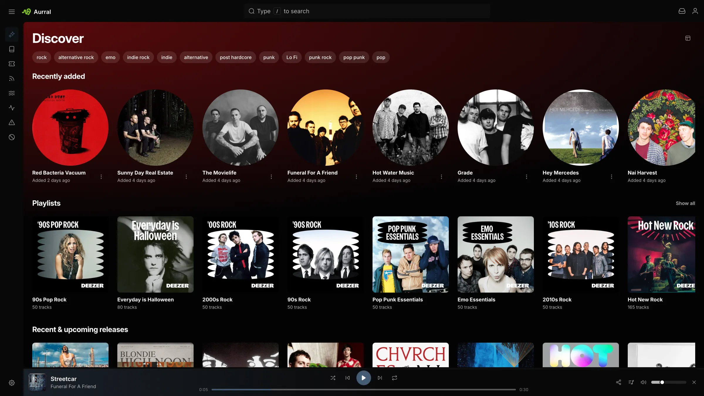
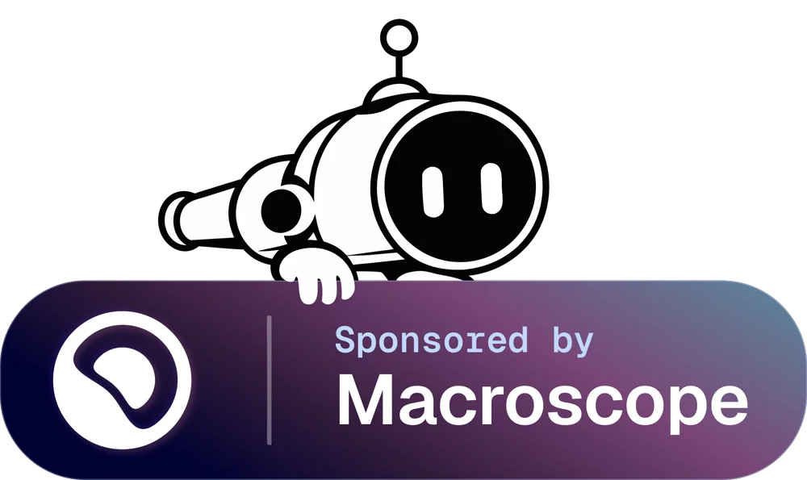

<div align="center" width="100%">
  <picture>
    <source media="(prefers-color-scheme: dark)" srcset="docs/src/assets/readme.svg" />
    
  </picture>
</div>

<p align="center">
  <a href="https://github.com/lklynet/aurral/releases"></a>
  <a href="https://github.com/lklynet/aurral/pkgs/container/aurral"></a>
  <a href="https://discord.gg/cpPYfgVURJ"></a>
  <a href="https://github.com/sponsors/lklynet/"></a>
</p>

<p align="center">Self-hosted music that doesn't feel like a chore. One container, zero API keys, and you own every file.</p>

<p align="center">
  <a href="https://aurral.org">Website</a> ·
  <a href="https://docs.aurral.org/">Docs</a> ·
  <a href="https://docs.aurral.org/faq/">FAQ</a> ·
  <a href="https://discord.gg/cpPYfgVURJ">Discord</a> ·
  <a href="https://github.com/sponsors/lklynet/">Sponsor</a> ·
  <a href="https://buymeacoffee.com/lkly">Buy me a coffee</a>
</p>

<p align="center">
  
</p>

- **Discover** artists you'll like, with a real reason for every pick. Bootstrap straight from your Spotify history.
- **Flows** turn your taste into scheduled playlists that grab their own tracks and rotate on autopilot. Daily mixes build from what you play.
- **Import** playlists from Spotify, YouTube Music, Last.fm, ListenBrainz, and M3U files.
- **Library** managed for you, with real audio verification, automatic tagging, and read-only folder support for music you don't want touched.
- **Listen** with synced lyrics and radio in the built-in player, from anywhere at [music.aurral.org](https://music.aurral.org), or in any Subsonic app. Already on Navidrome, Plex, or Jellyfin? Aurral writes M3U playlists and plays nice with all of them.
- **Friends** see what people on your server and your aurral.org friends are playing, and Blends mix your taste with theirs.
- **Share** tracks, albums, and playlists as links, publish public playlists, or let friends play straight from your Library.
- **Plugins** add download sources, imports, and actions when you want them.

Connect slskd, Usenet, qBittorrent, Tidarr, deemix, or download plugins for lossless music, with built-in yt-dlp ready as a fallback out of the box. Every integration is optional. [Read the docs](https://docs.aurral.org/) for the full tour, or check the [FAQ](https://docs.aurral.org/faq/).

## Quick start

```yaml
services:
  aurral:
    image: ghcr.io/lklynet/aurral:latest
    restart: unless-stopped
    ports:
      - "3001:3001"
    environment:
      - PUID=1000
      - PGID=1000
    volumes:
      - ./config:/config
      - ./data:/data
```

Run `docker compose up -d`, open `http://localhost:3001`, and create your admin account. No companion containers required to start. Want the latest changes early? Use the [`nightly`](https://docs.aurral.org/getting-started/docker/#choose-an-image-tag) tag.

## Thanks

Built on open music data from [MetaBrainz](https://metabrainz.org) ([MusicBrainz](https://musicbrainz.org), [ListenBrainz](https://listenbrainz.org), and the [Cover Art Archive](https://coverartarchive.org)) via [AurralBrainz](https://docs.aurral.org/integrations/metadata/). Chat on [Discord](https://discord.gg/cpPYfgVURJ), report bugs in [Issues](https://github.com/lklynet/aurral/issues).

## Sponsors

<p align="center">Aurral is free, MIT licensed, and has no paywalled pro tier. <a href="https://github.com/sponsors/lklynet/">Sponsors</a> and <a href="https://buymeacoffee.com/lkly">coffees</a> pay for AurralBrainz, the hosted metadata server, and keep it that way.</p>

<p align="center">
  <a href="https://github.com/bmikaili"></a>
  <a href="https://github.com/booxter"></a>
  <a href="https://github.com/Barosky"></a>
  <a href="https://github.com/robertdistefano"></a>
  <a href="https://github.com/pcsokonay"></a>
  <a href="https://github.com/okcodemaybe"></a>
  <a href="https://github.com/jakobbjelver"></a>
  <a href="https://github.com/zachgonser"></a>
  <a href="https://github.com/erleijen"></a>
  <a href="https://github.com/bahraoui"></a>
  <a href="https://github.com/nosooqua"></a>
  <a href="https://github.com/nichols89ben"></a>
</p>

<p align="center">
  <a href="https://macroscope.com/open-source">
    
  </a>
</p>
