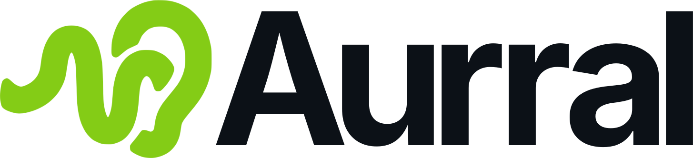
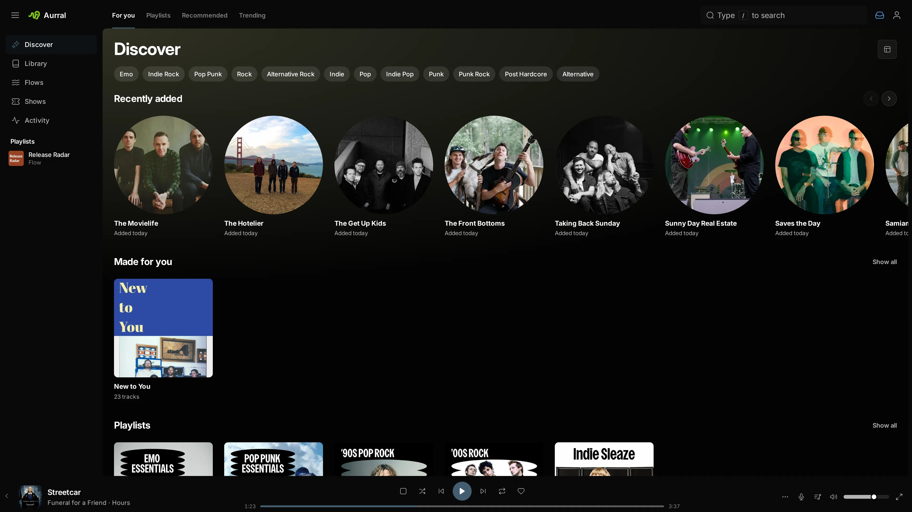
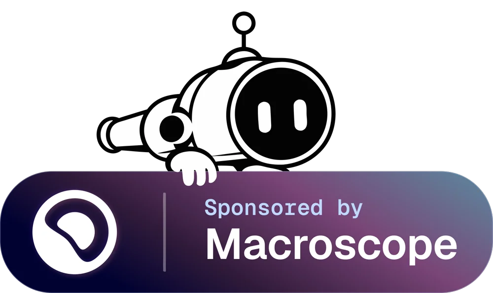

<div align="center" width="100%">
  <picture>
    <source media="(prefers-color-scheme: dark)" srcset="docs/src/assets/readme.svg" />
    
  </picture>
</div>

<p align="center">
  <a href="https://github.com/lklynet/aurral/releases"></a>
  <a href="https://github.com/lklynet/aurral/pkgs/container/aurral"></a>
  <a href="https://discord.gg/cpPYfgVURJ"></a>
  <a href="https://github.com/sponsors/lklynet/"></a>
</p>

<p align="center">Find new music, get it, and play it, all on your own server.</p>

<p align="center">
  <a href="https://aurral.org">Website</a> ·
  <a href="https://docs.aurral.org/">Docs</a> ·
  <a href="https://discord.gg/cpPYfgVURJ">Discord</a> ·
  <a href="https://github.com/sponsors/lklynet/">Sponsor</a>
</p>

<p align="center">
  
</p>

- **Discover** artists you'll love, with the reason for every pick. Start from your Spotify history.
- **Flows** turn your taste into scheduled playlists that download themselves.
- **Import** playlists from Spotify, YouTube Music, Last.fm, and ListenBrainz.
- **Library** that Aurral manages for you. Lidarr is optional.
- **Listen** in the browser, any Subsonic client, or Navidrome, Plex, and Jellyfin through the Library folder.
- **Share** anything as a link, and let friends play it from your Library.

Downloads through yt-dlp, slskd, Usenet, Tidarr, and deemix. Everything is optional. [Read the docs](https://docs.aurral.org/) for the full tour.

## Quick start

```yaml
services:
  aurral:
    image: ghcr.io/lklynet/aurral:latest
    restart: unless-stopped
    ports:
      - "3001:3001"
    environment:
      - PUID=1000
      - PGID=1000
    volumes:
      - ./config:/config
      - ./data:/data
```

Run `docker compose up -d`, open `http://localhost:3001`, and create your admin account. Want the latest changes early? Use the [`nightly`](https://docs.aurral.org/getting-started/docker/#choose-an-image-tag) tag.

## Thanks

Built on [BrainzMash](https://github.com/statichum/brainzmash-hearring-aid), [Honker](https://github.com/russellromney/honker), and [MusicBrainz](https://musicbrainz.org). Chat on [Discord](https://discord.gg/cpPYfgVURJ), report bugs in [Issues](https://github.com/lklynet/aurral/issues).

## Sponsors

<p align="center">Aurral is free and open source. <a href="https://github.com/sponsors/lklynet/">Sponsors</a> keep it that way.</p>

<p align="center">
  <a href="https://github.com/bmikaili"></a>
  <a href="https://github.com/booxter"></a>
  <a href="https://github.com/Barosky"></a>
  <a href="https://github.com/robertdistefano"></a>
  <a href="https://github.com/pcsokonay"></a>
  <a href="https://github.com/okcodemaybe"></a>
  <a href="https://github.com/jakobbjelver"></a>
  <a href="https://github.com/zachyzissou"></a>
  <a href="https://github.com/erleijen"></a>
  <a href="https://github.com/bahraoui"></a>
</p>

<p align="center">
  <a href="https://macroscope.com/open-source">
    
  </a>
</p>
