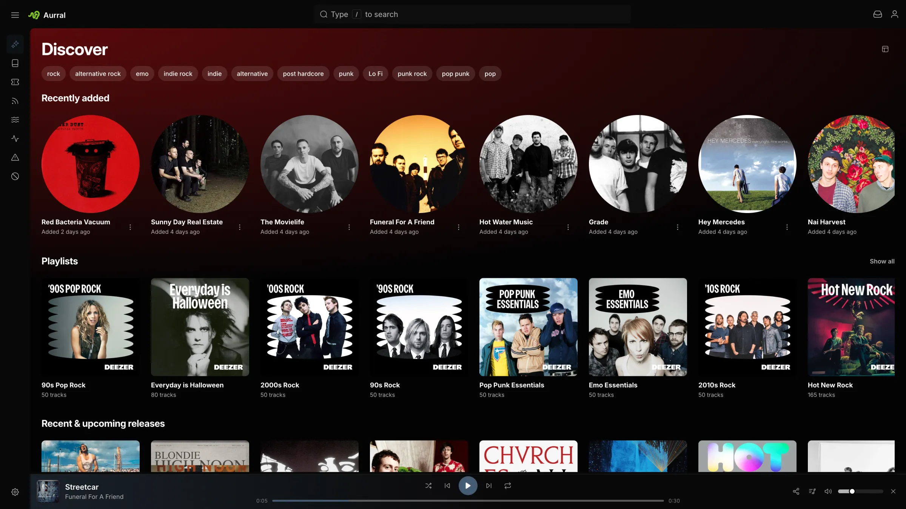

import { Card, CardGrid } from "@astrojs/starlight/components";

Aurral is a self-hosted music app that handles discovery, downloads, library management, and playback in one container. It finds artists you don't have yet, grabs tracks for your flows and imported playlists, verifies and tags the files, and plays everything in the browser, at [music.aurral.org](/using/music-aurral-org/), or in any Subsonic app.

## Get started

1. [Install Aurral with Docker](/getting-started/docker/).
2. [Set up the shared filesystem](/getting-started/storage/) if you're connecting other downloaders or media servers.
3. [Complete first-run setup](/getting-started/first-run/).
4. Connect whatever optional services you actually want, or skip all of them and just start listening.

## How Aurral fits

Aurral manages its own Library folder and can also index read-only folders you don't want touched. Everything in Aurral works standalone with nothing else connected. If you already run Navidrome, Plex, or Jellyfin, point them at the Library folder and Aurral's M3U playlist files and they pick everything up automatically.

## Essential guides

<CardGrid>
  <Card title="Use the app">
    Discover, Search, Library, Playlists, Activity, Shows, and Settings. [App
    overview](/using/overview/)
  </Card>
  <Card title="Create playlists">
    Build a scheduled flow or import a playlist. [Playlists overview](/using/playlists/)
  </Card>
  <Card title="Listen with friends">
    See what friends are playing and make Blends. [Friends](/using/friends/)
  </Card>
  <Card title="Use it anywhere">
    Your server at one address, from any browser. [music.aurral.org](/using/music-aurral-org/)
  </Card>
  <Card title="Run Aurral">
    Storage, users, environment variables, and troubleshooting. [Administration](/admin/storage/)
  </Card>
  <Card title="FAQ">
    Answers to common questions about self-hosting, downloads, and integrations. [Read the
    FAQ](/faq/)
  </Card>
</CardGrid>

## Links

- [aurral.org](https://aurral.org)
- [GitHub](https://github.com/lklynet/aurral)
- [Discord](https://discord.gg/cpPYfgVURJ)
