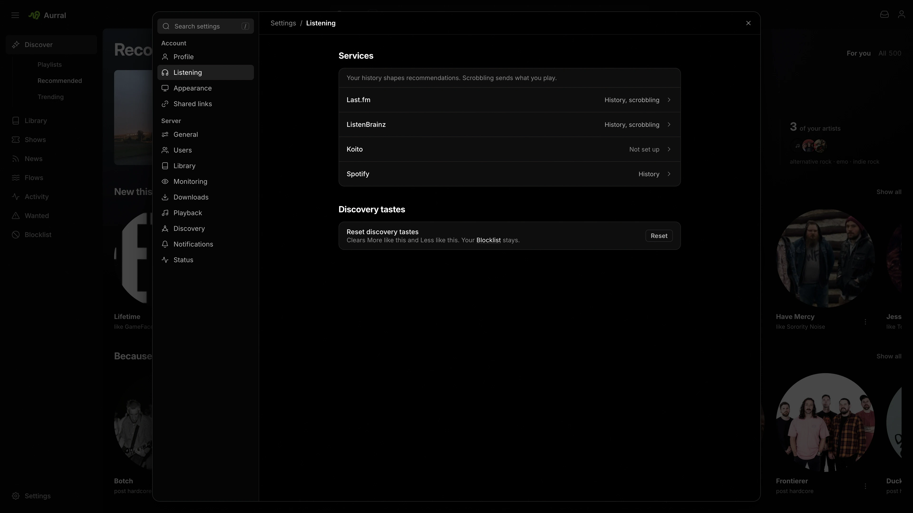

[Koito](https://koito.io/) is optional. It is a self-hosted scrobbler that is compatible with ListenBrainz.

Aurral can use your Koito history for personal recommendations. You do not need the public ListenBrainz service.

## Set up Koito for your user

Each user sets up Koito for their own account:

1. Open **Settings > Listening > Koito**.
2. Enter a Koito URL that the Aurral server can reach, for example `https://koito.example.com:4110`.
3. To send plays to Koito, enter the **API key** and select **Connect Koito**.

Aurral reads your top artists from the Koito chart API. It uses them for recommendations and discover playlists.

Aurral sends finished plays and now playing to Koito through its ListenBrainz-compatible `submit-listens` endpoint. If Koito is down, Aurral keeps the plays in its own history.

## Requirements

- A Koito instance with scrobbles
- Enough history for useful top-artist charts
- MusicBrainz IDs on the Koito artists, so that Aurral can match them to your Library

Koito supplies listening history only. Similar artists and tags come from Deezer and ListenBrainz either way.
