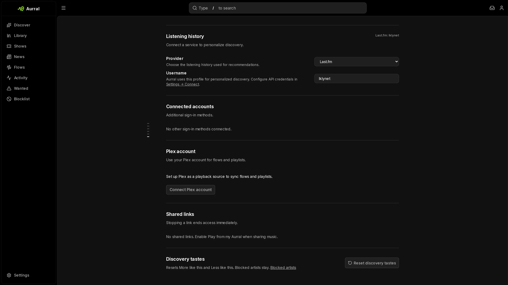

Last.fm is optional. Without it, Aurral gets similar and trending artists from ListenBrainz. A Last.fm API key switches recommendations, trending artists, tag search, and flows to Last.fm, which usually finds closer matches. See [ListenBrainz and Last.fm](/using/discover/#listenbrainz-and-lastfm).

On artist pages, Aurral reads genres from BrainzMash first. For artists that BrainzMash has no genres for, it uses Last.fm tags, or ListenBrainz tags when there is no key. It keeps only the tags that are real genres.

## Add the API key

An admin adds the Last.fm **API key** and **Shared secret** in **Settings > Discovery > Last.fm**. Aurral uses the key for discovery data. It uses the key and the secret together to connect scrobbling accounts.

## Scrobble to Last.fm

1. Open **Settings > Listening > Last.fm**.
2. Select **Connect Last.fm**.
3. Approve access in the Last.fm window.

Aurral stores a Last.fm session key for each user. Navidrome is not required.

Each user connects their own account while signed in. The instance API key cannot connect an account, because it does not identify a user.

## Per-user listening history

Each user can add a Last.fm username in **Settings > Listening > Last.fm**. Connecting scrobbling fills it in. Aurral reads it with the admin's API key, so without a key, use ListenBrainz or Koito instead.

Aurral combines every history source a user adds with the plays recorded in Aurral.

## How Aurral sends plays

Aurral records each play from the built-in player and from Subsonic clients before it contacts Last.fm. If Last.fm is down, playback continues and Aurral keeps the play.

Aurral queues each play and retries temporary failures. Because of the retries, Last.fm can receive the same play twice. Aurral's own history does not depend on the result.

## Discovery settings

An admin sets the refresh interval and the discovery mode in **Settings > Discovery**. The modes are Safer, Balanced, and Deeper.

If Last.fm is unavailable, users can add ListenBrainz or [Koito](/integrations/koito/) history in **Settings > Listening**.
