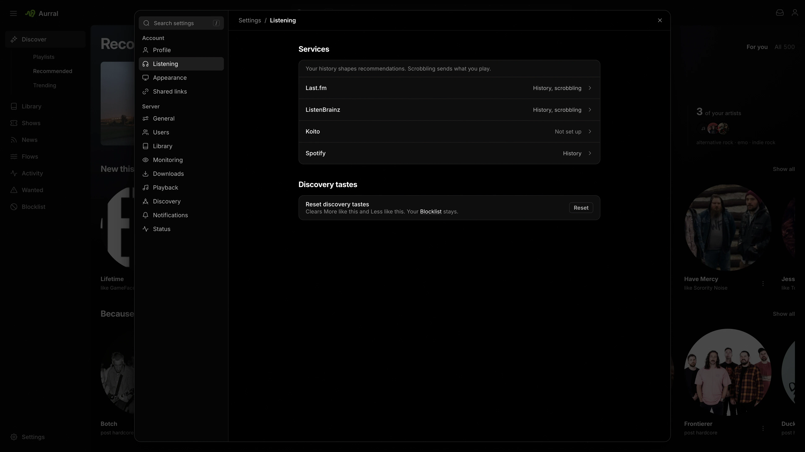

ListenBrainz is optional. Discover works without it. Connecting your account adds your listening history to your recommendations and sends your plays to ListenBrainz.

## Connect your account

Each user connects their own account:

1. Open **Settings > Listening > ListenBrainz**.
2. Enter your **User token** from your [ListenBrainz settings](https://listenbrainz.org/settings/).
3. Select **Connect ListenBrainz**.

Connecting fills in your username, and Aurral reads your top artists from it for recommendations. To use a public history without scrobbling, enter only the username.

Each user connects while signed in. The instance API key cannot connect an account, because it does not identify a user.

## How Aurral sends plays

Aurral records each play from the built-in player and from Subsonic clients before it contacts ListenBrainz. If ListenBrainz is down, playback continues and Aurral keeps the play.

Aurral queues each play and retries temporary failures for about 17 hours. Because of the retries, ListenBrainz can receive the same play twice. Aurral's own history does not depend on the result.

For a song in your Library, Aurral sends the MusicBrainz IDs from the file's tags: every artist credited on the song, and the release you played it from. A song on a compilation counts for its own artists, not Various Artists.

## Coming from Last.fm

Aurral no longer connects to Last.fm, because from December 1, 2026, the Last.fm API needs Last.fm Pro. Aurral gets similar artists from Deezer and ListenBrainz for everyone instead.

To keep your Last.fm history in your recommendations, connect Last.fm under **Connect services** in your [ListenBrainz settings](https://listenbrainz.org/settings/music-services/details/), then connect ListenBrainz in Aurral.

Last.fm station imports still work. See [Import from Last.fm](/using/playlist-imports/#import-from-lastfm).
