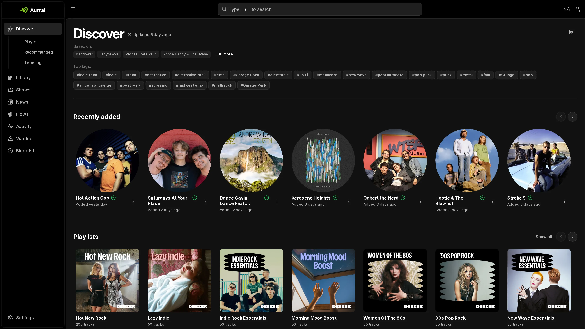
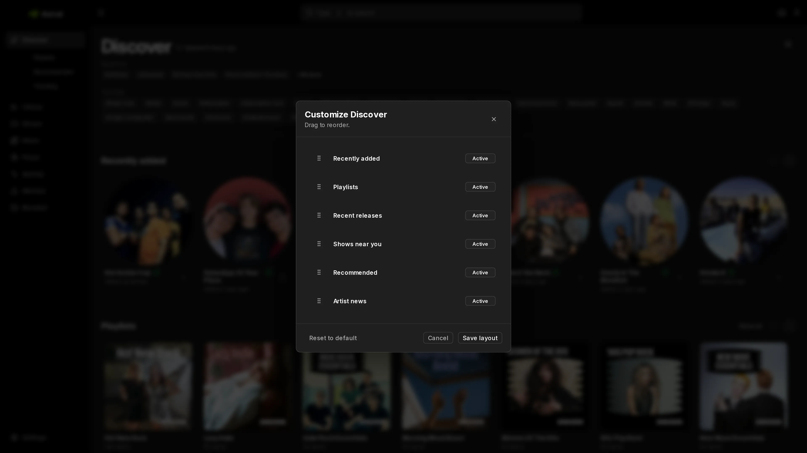
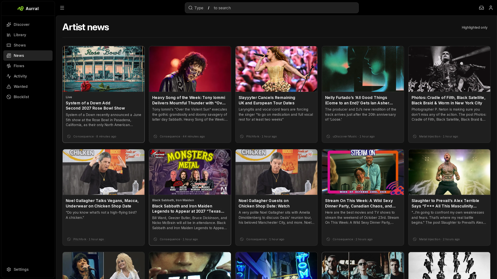

Discover is Aurral's home page. It shows personal recommendations, trending artists, tags, recent and upcoming releases, playlists, artist news, and recently added artists. When an admin configures Ticketmaster, Discover also shows nearby events.

Aurral recommends artists that fit your taste but are not in your Library yet. It uses your Library, your listening history, and similar-artist data from ListenBrainz, or from Last.fm when an admin adds a Last.fm API key.

## What shapes recommendations

Each user gets their own recommendations. Aurral picks a set of seed artists for you and looks up artists similar to them. The seeds come from:

- Artists you marked **More like this**
- Your listening history in Aurral, and from Last.fm, ListenBrainz, or Koito
- A sample of your Library. Recently added artists are always in the sample, and the rest changes on every refresh.

Aurral then ranks the results by how similar they are, how well their genres match your seeds, and how many of your seeds point to them. Aurral only uses tags that name a genre on MusicBrainz, plus a few broad ones like indie and rap, so tags like "seen live" or "female vocalists" don't show up as genres or count toward matches. Trending artists are the same for everyone.

Each recommendation names the seeds it came from, such as "like Slowdive". A pick that reads "via Grouper" came from another recommendation instead of one of your seeds.

**More like this** makes the artist a seed and moves artists like it up your list. **Less like this** moves the artist and related picks down, and stops Aurral from using the artist as a seed. Neither one hides an artist.

**Block artist** excludes an artist for you only. Aurral removes that artist from your recommendations, playlist previews, and future downloads. To manage the list, open **Blocklist** in the sidebar.

**Block genre** excludes a genre for you only. Use it on a genre's page or in **Blocklist**. Aurral hides recommended artists tagged with that genre, drops the genre from your top tags, and keeps flows from picking new artists in it. Artists in your Library are never hidden.

Feedback reorders your list right away. Aurral saves it for the next scheduled rebuild, which uses artists you liked as seeds to bring in new picks. An admin sets the schedule in **Settings > Discover**. A new user sees **Building your personal recommendations** until their first set is ready.

## ListenBrainz and Last.fm

Discover works without an account or API key. Aurral finds similar artists on ListenBrainz, genres on MusicBrainz, and the top tracks that flows use on Deezer. **Trending artists** comes from the Deezer charts. See [Trending](#trending).

ListenBrainz similar artists lean toward well-known names, so Last.fm usually gives closer matches. When an admin adds a Last.fm API key in **Settings > Connect > Last.fm**, Aurral uses Last.fm for recommendations, tag search, and flows, including the trending artists that flows and shows use. **Settings > Discover** shows which one is in use. When an admin adds or removes the key, Aurral rebuilds everyone's recommendations.

## Discovery modes

An admin sets the mode in **Settings > Discover**.

| Mode     | Best for                                      |
| -------- | --------------------------------------------- |
| Safer    | Familiar recommendations with high confidence |
| Balanced | A mix of familiar picks and new ground        |
| Deeper   | More artists outside your usual library       |

## Customize the page

To choose and order the sections on your Discover page, select **Customize Discover**. Shows and news can show as a list, square cards, or wide cards. Each user has their own layout.

## Recently added

**Recently added** lists the 20 artists whose music most recently entered your Library, newest first. It uses the same file times as the Library's **Recently added** sorting, so an artist moves to the front when a new album finishes downloading. Artists without downloaded music don't appear. The list updates after each library scan.

## Recent and upcoming releases

**Recent & upcoming releases** lists new and upcoming albums from library artists that have a MusicBrainz ID. Aurral builds this list from BrainzMash, its hosted metadata service. Lidarr is not required. It also adds new releases from your recommended artists, which Aurral reads from ListenBrainz every few hours.

Aurral checks each artist's releases about once a day. New artists are checked when they first appear, after a library scan or when you add them. If BrainzMash can't load an artist, Aurral tries that artist again after an hour. It leaves out albums that are already in your Library. If BrainzMash is unavailable, Aurral keeps the last list that it loaded.

To get a release, select **Download album**. Lidarr downloads it when Lidarr is connected, and Aurral downloads it otherwise. See [Who manages your library](/using/library/#who-manages-your-library).

## Artist news

When an admin turns on news in **Settings > RSS news**, Discover shows recent stories from the enabled feeds. Stories that mention a library artist or a recommended artist are highlighted with the artist's name. Aurral keeps stories for 30 days, even after they leave a feed.

Aurral highlights a story when an artist's full name appears in its headline, or when the publisher tags the story with that artist. One-word names such as Ghost or Live are common words, so for publishers that tag their stories, Aurral highlights those artists only when the tag names them.

To open the full news page, select the **Artist news** title or **Show all**, or **News** in the sidebar. Select **Highlighted only** to list only the stories that mention your artists. If a feed has no photo for a story, Aurral takes one from the story's page, or uses the artist's image. Admins can turn off a feed for everyone with the disable icon beside the publisher name on a story.

## Open artists and albums

Select an artist or album card to open its Discover page. To open an artist card's menu instead, right-click it or press and hold it on a touch screen. If the artist or album is in your Library, select **Open in library** to open its Library page. There you can play tracks and mark favorites.

Artist pages show up to six **Popular** tracks, followed by up to three YouTube videos. Aurral checks those tracks in order and skips missing or duplicate video matches. It prefers uploads from the artist's own channel and uses the same artist, title, and version checks as yt-dlp downloads. Videos use YouTube's native controls. If none of the six tracks has a match, the video section stays hidden. If video search fails, select **Retry**.

## Playlists

**Discover > Playlists** shows playlists made by Deezer's editors, grouped by genre. They need no account or API key. When Aurral knows your top genres and tags, **For you** shows the editor playlists that match them. The Discover page shows a few of these playlists too. Open one to play the Deezer previews for its tracks.

Select **Add synced playlist** to save it as a synced playlist. Aurral checks Deezer for changes every 24 hours. When the editor removes a track, it leaves your playlist but its file stays in your Library. See [Sync schedule and removed tracks](/using/playlist-imports/#sync-schedule-and-removed-tracks).

To keep only some tracks, use a track's menu to add it to your Library or to a playlist. To add several at once, select the tracks first. Selecting an artist or album name looks it up in MusicBrainz and opens its page.

Earlier versions built their own playlists, such as Discover Weekly and Release Radar, during each discovery refresh. Those are now flow templates. See [Flows](/using/flows/#start-from-a-template). Flows you created from editorial Last.fm playlists keep their tracks, but they no longer update.

## Recommended

**Discover > Recommended** shows every recommendation you have. **For you** starts with your top pick and puts each other artist in one row:

- **New this week**: artists that joined your list in the last 7 days. Your first set of recommendations doesn't count as new.
- **Because you like**: a row for each seed with enough picks of its own.
- **Close to home**: the rest of the artists similar to your seeds.
- **Further out**: artists Aurral found through another recommendation.

Below the rows, **Your taste** shows your top genres and **Based on** lists your seeds. Select either to see its picks.

**All** lists your recommendations in order. Filter by new, close to home, further out, genre, or seed, and select **#**, **Artist**, or **First seen** to sort. Aurral opens the view you used last.

## Trending

**Discover > Trending** shows what's popular right now: top songs, albums, and artists, a chart for each genre, and popular playlists. It needs no account or API key. Songs, artists, and genre charts come from Deezer, and albums come from Apple Music. Aurral updates them every 6 hours. The **Trending artists** row on Discover shows the same top artists.

The charts follow the country your server is in. If Deezer or Apple Music has no chart for that country, Aurral shows the worldwide songs chart or the US albums chart instead.

Aurral saves the songs chart once a day, so rank changes and days at No. 1 appear after your server has been running for two days.

Select **Save as playlist** to add the top songs as a synced playlist that follows the chart. Open a genre chart to play its previews, or to add its tracks to your Library or a playlist.

## Per-user listening history

Each user chooses a listening-history provider in **Profile > Listening history**. Choose **Local only**, enter a Last.fm or ListenBrainz username, or enter a Koito URL. Aurral always uses the plays recorded in Aurral, and adds history from the selected provider. When you change the provider, Aurral rebuilds your recommendations.

## Shows

When an admin configures Ticketmaster, Discover shows nearby events for recommended, trending, and library artists. See [Ticketmaster](/integrations/ticketmaster/).
