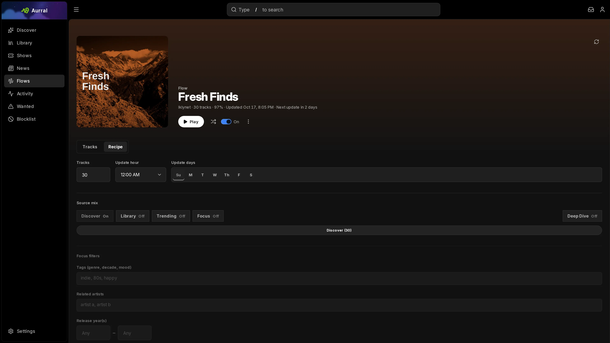

A flow is a playlist that Aurral builds again on a schedule. Aurral downloads flow tracks as temporary files under `_flows` in the Library folder. It can publish the flow to Navidrome, Plex, or Jellyfin without adding the files to the Library.

A flow has three groups of settings:

1. **Updates** sets when the flow runs.
2. **Tracks** sets where the tracks come from and how many each source adds.
3. **Filters** limits every source to tags and release years, and can leave tags out.

## Start from a template

Select **New flow** and choose **Blank flow** or a template:

- **Discover Weekly** picks from your recommendations.
- **Trending Mix** picks from trending artists.
- **Library Blend** picks from artists in your Library.
- **Listening History** follows artists you've played recently. It appears only when Aurral has listening history for you.
- **Release Radar** picks one track from each recent album you don't have yet.

You can change any template's recipe afterwards.

A new flow runs only after you turn it on. A flow that is turned off keeps its settings but does not run.

## Tracks

Set how many tracks each source adds. A source set to 0 is off. The flow's size is the total.

| Source       | Tracks come from                                                                                                                 |
| ------------ | -------------------------------------------------------------------------------------------------------------------------------- |
| Discover     | A rotating pick from your top recommendations. Excludes library artists, blocked artists, and blocked genres.                    |
| Library      | Artists in your Library, skipping tracks you already have.                                                                       |
| Trending     | This week's trending tracks. Excludes library artists, blocked artists, and blocked genres.                                      |
| Focus        | Artists similar to the ones you pick or to your recent listening. Excludes library artists, blocked artists, and blocked genres. |
| New releases | One track from each recent album by a library artist that you don't have yet.                                                    |

Under each track title, the flow shows why Aurral picked it, such as "Similar to Pusha T" or "Trending this week".

## Filters

**Tags** and **Released** apply to every source that is turned on.

- **Tags** keep artists that carry at least one of your tags. Spelling variants match, so `hip-hop` and `hip hop` are the same tag.
- Start a tag with `-` to leave out artists that carry it, such as `-christmas`. This works with or without other tags.
- **Released** keeps tracks from releases that first came out in that range. Leave a year blank for no limit.

Year range examples:

- `1980` to `1989` for one decade
- `2020` to blank for 2020 and later
- blank to `2000` for 2000 and earlier

Narrow filters can leave a source with fewer matches than you asked for. Aurral fills the gap from your other sources, and otherwise makes a shorter playlist. The flow's track count shows how many tracks it found.

To enter several tags or artists, separate them with commas. Aurral turns the text into entries after each comma, or when you leave the field. It ignores duplicates.

## Focus

Focus finds artists outside your Library from three kinds of seeds:

- **Similar to** artists you pick.
- **Recent listening**, which uses the artists you've played most recently each time the flow runs.
- Your **Tags**, which Focus also searches by.

Focus needs at least one of these. It takes turns between them, starting with the closest matches for each.

## Updates

Pick the days when the flow can run and the hour of those runs.

## Deeper cuts

**Deeper cuts** changes which tracks Aurral takes from each artist. When it is off, Aurral uses the artist's top 10 tracks. When it is on, Aurral uses tracks 10 to 25. If an artist has too few tracks in that range, Aurral falls back to the top 10.

## Flow options

Open the flow menu to set these options:

- **Download automatically** downloads new tracks each time the flow runs. Turn it off to see the picks first: tracks you already have stay playable, and the rest wait as **Not downloaded** and play a 30-second Deezer preview. Previews never count as plays. Download one from its track menu, or all of them with **Download all** in the flow menu. A new flow starts with this off when no download source is set up, and a flow without a download source always waits.
- **Scrobble tracks** controls whether Aurral records plays from this flow in your listening history. Turn it off to keep these plays out of your recommendations and your scrobbling services. Plays recorded before the change stay.
- **Show in library** adds the flow's current tracks to the Library pages. It is off by default. A track leaves the Library when it rotates out of the flow, when you turn the option off, or when you delete the flow. Aurral does not move or copy the files. Lidarr and your playback servers do not change.

## How a flow runs

When a flow runs, Aurral:

1. Collects candidates for each source that is turned on, keeping only tracks that match your tags and years.
2. Picks the playlist with one song per artist.
3. Moves any shortfall in one source to the other sources.
4. Sends the playlist to the download worker, unless **Download automatically** is off.

A track that fails to download stays failed until you re-search it or the flow runs again. See [Playlist imports](/using/playlist-imports/#download-retries-and-failures).

## Keep flow tracks

Each run replaces the flow's tracks, including ones you downloaded from it.

- To keep one track in the Library, select **Add to library** in the track menu.
- To save all finished tracks as a static playlist, select **Save as playlist** in the flow menu. Aurral names the new playlist after the flow, with `Static` at the end.

## Replace a flow track

To replace a finished track that Aurral downloaded, right-click it and select **Re-search**:

- **Automatic** lets Aurral search for and choose a new recording.
- **Manual** opens a search in one download client. You choose the result. See [Choose a download yourself](/using/activity/#choose-a-download-yourself).

The current file stays available until the replacement passes Aurral's checks.

## Lidarr import list

Each flow can publish a URL that Lidarr reads as a **Custom List**. Copy it with **Copy Lidarr import URL** in the flow menu. See [Lidarr: Import list feeds](/integrations/lidarr/#import-list-feeds).
