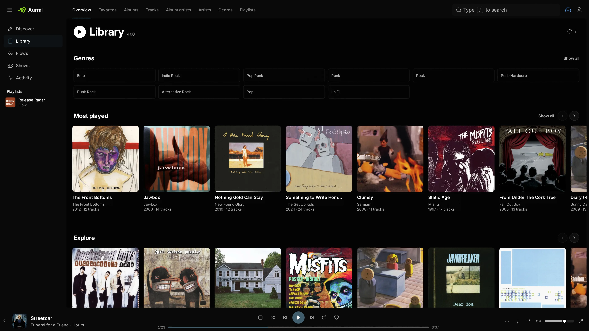

The Library is Aurral's index of your music. It includes the files in the Library folder and in your [read-only folders](#add-music-aurral-only-reads). Open **Library** in the sidebar to see these sections:

- **Library** shows your genres, your most played, recently added, recently played, and recently released albums, a random selection to explore, your mixes, and your playlists.
- **Favorites** shows your starred artists, albums, and tracks.
- **Albums** shows album artwork and how many tracks are available.
- **Tracks** shows each track, its artist and album, and whether its file exists.
- **Album artists** and **Artists** list the artists.
- **Genres** opens the album list for one genre. A genre tag that lists several genres separated by `;` counts under each of them. Other separators such as `/` and `,` stay part of the genre name.
- **Playlists** shows your static playlists. Flows have their own **Flows** item in the sidebar.

To filter the current section, use the search field in the toolbar. The filter button narrows a section by genre, and Artists and Albums also by status: **Monitored**, **Not monitored**, or **Missing tracks**.

## Play and browse

Select a track or album to play it in the built-in player. An artist or album page shows its tracks, playback controls, and favorites. An album lists every track of its release, so the tracks you do not have appear dimmed and cannot play. To get them, see [Albums and tracks](#albums-and-tracks). To see which release an album lists, see [How the Library finds new files](#how-the-library-finds-new-files).

While a track is in the player, press **Space** to play or pause, **←** and **→** to move 5 seconds, **Shift+←** and **Shift+→** for the previous or next track, **M** to mute, **L** for lyrics, and **F** for the full screen player. The keys do nothing while you type in a field.

To see what plays next, select the queue button in the player. Drag tracks or use the handle with Space and the arrow keys to reorder them, remove one, or clear everything after the current track. To keep what's playing and up next, select **Save as playlist**. On a phone, the queue is in the Now playing view. Any track menu with a playable track has **Play next** and **Add to queue**. When nothing is playing, either one starts the track.

To read along, select the lyrics button in the player. On a phone, tap the artwork in the Now playing view. Aurral uses a `.lrc` file with the same name as the track first, then lyrics in the file's tags, then [LRCLIB](https://lrclib.net). Timed lyrics follow the song, and selecting a line jumps to it.

The full screen player shows the song big enough to read across a room, and works as a screen saver: the controls fade when you stop moving the mouse, and the screen stays awake while music plays. Select the full screen button in the player, or press **F**. Its settings button picks a layout, either just the current lyric, lyrics and queue in tabs, or both side by side on a wide screen, and a visualizer. **Chill** drifts slowly. **Beat** moves with the bass of tracks in your Library. Press **Esc** to leave.

Aurral remembers your queue on the server. After a reload, or when you open Aurral on another device, the player comes back paused at the track and time you left. A paused player picks up what you play elsewhere, including Subsonic clients that save their play queue. Previews and tracks outside your Library and playlists stay on the device that played them. Logging out stops playback. If you play in a second tab, the first tab pauses.

**Volume leveling** in **Settings > Listening** plays every track at a similar loudness. Aurral measures each file the first time it plays and remembers the result, so files don't need ReplayGain tags. Loud tracks are turned down to match, and quiet ones play as they are. It's on by default, and the setting belongs to each device. iPhone and iPad browsers don't let a page change the volume, so leveling has no effect there.

The player stays at the bottom of the page. To get the room back, minimize it into the sidebar, and select it there to bring it back.

Each artist and album has a Discover view and a Library view. On a Library artist page, select **Full discography** to see releases, tags, similar artists, and previews. On a Discover page, select **Open in library** to go back.

Album artwork comes from your files first: the cover embedded in a track, then a `cover`, `folder`, `front`, or `album` image in the album's folder. An album without one shows the artwork from its metadata. When newly added music in Aurral's own folder has no cover, Aurral saves that artwork as `cover.jpg` beside the tracks, so apps that read the folder, like Navidrome, show it too. It never replaces an image that is already there. Artists show their photo, or the art of one of their albums. Aurral keeps a copy of each and updates an album's copy when its tracks change. After you replace an image file beside the tracks, select **Clear artwork cache** in **Settings > Discovery**. To pick your own cover, select **Change artwork** in the album's menu. For an album in Aurral's own folder, this also saves your pick as the folder's `cover.jpg` and keeps the cover that was there as `cover-original.jpg`. Removing your pick puts that cover back.

Favorites belong to each user. They work in the built-in player and in Subsonic clients.

**Most played** on a Library artist page shows the ten tracks you play most, counting plays from Subsonic clients and imported listening history. It appears once you play something by the artist. Subsonic clients get the same order, followed by the tracks you haven't played.

To open a track, album, or artist menu, select its options button, right-click it, or press and hold it on a touch screen. Use the track menu to add a track to a playlist or remove it. To see the indexed metadata of an artist, album, or track, select **View info** in its menu.

The page tells you when library data is stale, when files are partial or missing, when a service has a problem, and when a list is empty.

The Library lists the music you can play, plus the albums Aurral is downloading for you. To see the rest of an artist's discography and request it, open the artist's Discover page. When an artist has several releases with one title, each card shows its year, and singles and EPs say so.

On a Discover artist page, you can search releases by title. Filter by all releases, albums, EPs and singles, or compilations. To show or hide live releases in any filter, use the **Live albums** switch.

### Radio and autoplay

To play music like a track, album, or artist, select **Start radio** in its menu, or the radio button in the player for the current track. A station plays only music in your Library: the artist itself, similar artists when [Last.fm](/integrations/lastfm/) or ListenBrainz knows them, and artists that share its genres. It keeps going until you play something else, favors your favorites, and holds back songs you played in the last day and artists you blocked in Discover.

When the queue runs out, **Autoplay** continues with music like what you just played. The upcoming autoplay tracks show under **Autoplay** in the queue, below anything you queued yourself. Turn the switch there off to stop when the queue ends. Aurral remembers the switch in this browser, and autoplay waits while repeat is on.

Subsonic clients get the same stations through their instant mix or similar songs feature.

## Add music

Aurral monitors artists and downloads albums and tracks with your download sources into the Library folder. To get an album, select **Download album**. To get a track, select its **+** button and choose **Add to library**. To follow an artist, open the artist's page and select **Monitor**. Discover and Search cards don't add artists. See [Artists](#artists).

Music you already have joins the Library from a [read-only folder](#add-music-aurral-only-reads) or an [import](#bring-your-existing-music).

## Monitor music

Monitoring decides what Aurral does by itself. It works at three levels: artist, album, and track. Unmonitoring never deletes files. To remove music, see [Remove tracks, albums, and artists](#remove-tracks-albums-and-artists).

### Artists

An artist's monitoring decides which of its releases download by themselves. On a Discover artist page, select **Monitor** and make a choice. The button then shows it. On a Library artist page, the same choices are in the artist's menu. Every artist starts **Not monitored**, so you never add an artist first.

#### Monitoring rules

An artist is **Monitored** or **Not monitored**. A monitored artist follows the default rules, unless you give it its own. To see or change an artist's rules, select **Monitoring rules…** in its monitoring menu and turn off **Use the default rules**. While you change the rules, Aurral lists the releases and top tracks it would download, and what it skips and why. An artist with its own rules shows **Custom rules**.

An admin sets the default rules in **Settings > Monitoring > Default rules**. Before a change is saved, Aurral shows how many artists use the default and what it would download for them. A change applies to those artists from the moment you save it.

- **Back catalogue** takes the releases that are already out: **Everything**, everything **Since a year**, the **Latest releases**, up to 10, or **Nothing**. It counts what was out when you saved the rules, so **Latest releases** keeps the same releases when the artist puts out another one.
- **New releases** downloads the releases that come out after you start monitoring.
- **Release types** chooses albums, EPs, and singles. **Also include** adds releases with a secondary type, such as live albums, compilations, soundtracks, remixes, demos, DJ mixes, and mixtapes. Aurral only takes official releases.
- **Edition** chooses the **Standard** tracklist or the **Expanded** edition. See [Follow an Aurral album download](#follow-an-aurral-album-download).
- **Top tracks** downloads up to 50 of the artist's most popular songs that its releases don't already bring. The list comes from Last.fm when you set a Last.fm API key, and from Deezer otherwise.

The default rules take every album and EP and the new releases. Aurral skips a single, EP, or other release when every song on it is already in your Library or on another release it downloads. A studio album is never skipped this way.

After you change an artist's monitoring, Aurral reports what it queued and why it skipped the rest. If Aurral cannot load the artist's releases, it tells you and keeps the old rules. Aurral checks the artists it monitors for new releases and top tracks once a day.

Artists that an earlier version monitored with **All albums** use the default rules. **Future albums** and **Latest album** became rules that do the same. Artists on **First album** are now **Not monitored**, and the album they downloaded stays monitored.

A Library artist's menu also has **Delete artist**. See [Remove tracks, albums, and artists](#remove-tracks-albums-and-artists).

### Albums and tracks

Downloading something monitors it. When you download an album, Aurral monitors the album and every track on it. When you download one track, Aurral monitors that track only. A monitored track gets everything Aurral does by itself: Aurral downloads it, searches again when it is missing from an album you asked for, and upgrades its file below your quality cutoff. An unmonitored track stays as it is. This includes monitored tracks that Aurral did not download, such as ingested music.

A track can be monitored on its own. A single that a synced playlist downloaded puts its album in your Library. The album is unmonitored, and the playlist's track is monitored. Files that Aurral did not download, such as music you copied into the download folder, start unmonitored.

- To get the rest of an album, open its Library page and select the download button next to **Add to favorites**. Aurral looks up the full track list and downloads what is missing.
- To get one missing track, select the download button on its row. Aurral downloads the track.
- To stop monitoring an album, open the album's menu and select **Stop monitoring album**. This stops monitoring every track on it.
- To stop monitoring one track, open its menu on the album page and select **Stop monitoring track**. An unmonitored track shows a crossed-out eye. Aurral keeps its file and stops upgrading it, so this is also how you keep a copy you are happy with.

If the album or track has unfinished downloads, Aurral asks you to confirm. It then cancels those downloads and keeps every finished file. To monitor something again, download it. When nothing is missing, the menu offers **Monitor track** or **Monitor album** instead. An album you unmonitored stays unmonitored when you change the artist's monitoring later.

**Wanted** does not list unmonitored tracks. **Retry** on an album skips the tracks you unmonitored. **Re-search** on one track still works when it is unmonitored.

### Search again for missing tracks

Aurral searches again for missing tracks that you monitor. It checks every hour and searches every album you asked for that has a monitored missing track and no search or download in the last day. It skips unmonitored tracks. After you cancel an album's downloads, Aurral leaves that album alone until you select **Retry**.

## Follow an Aurral album download

A monitored album shows its download state on its page, such as **Queued**, **Downloading**, **Partially available**, or **Needs attention**. An album is complete when every track you monitor is available.

When the Library already lists the album from your files, Aurral asks for the tracks of that release. Otherwise it asks for the tracklist that most releases of the album share, in the order most of them share. That is usually the standard edition rather than a deluxe edition, a box set, or a pressing that swaps tracks. Aurral remembers the release it asked for. When you download the album again, it asks for the same release, even if your files turn out to be another one, until you change the artist's **Edition**.

An album's page lists the release Aurral downloads for that album: the one described above when the album is in your Library, or else the standard edition. A track you add from the page asks for that release, with its disc and place on it, and goes to that album when another album in your Library also has the track. A playlist you save the track to keeps that release.

When an album has more than one edition, such as a standard and a deluxe edition, its page names the edition in the line under the artist. Select it to see another edition's tracks, date, and length. Your Library keeps its edition until you select **Use this edition**. The album then lists that edition's tracks, shows the ones you lack as missing, and downloads that edition from then on, even after a scan. Songs you have from other editions stay on the album under **From other editions**. To download another edition of an album that is not in your Library, select it before you download.

Aurral takes tracks from a Soulseek folder, a Usenet download, or a Tidal or Deezer album only when it holds exactly that release. A deluxe edition with a bonus track, a shorter edition, or a folder with a live version of a song is a different release, so Aurral passes over it. When no source has the release, Aurral searches for each missing track on its own. See [Download source priority and fallback](/integrations/usenet/#download-source-priority-and-fallback). A shorter download does not complete the album. The tracks it lacks stay monitored, and Aurral keeps searching for them.

To get single tracks fast, drag yt-dlp above slskd, Usenet, and deemix in **Settings > Downloads > Download clients**. A track you download on its own, or one from a playlist or a flow, then comes from yt-dlp first, so you can listen sooner. If yt-dlp has no match, Aurral looks for the track's release and then searches the other sources for the track. An album you download never starts on yt-dlp. With **Automatic upgrades** on, Aurral later replaces a yt-dlp file with a better copy from the release. See [Track upgrades](/using/playlists/#track-upgrades).

When the artist's rules choose the **Expanded** edition, Aurral asks for the longest edition that keeps every standard track and is at most twice as long, such as a deluxe edition but not a box set. A standard-edition folder does not count as that release. Switching an artist to **Expanded** also adds the extra tracks of its albums already in your Library. An expanded edition must use the same recordings as the standard tracks, so a remaster with its own recordings is not treated as one.

- To stop unfinished tracks, select **Cancel downloads**. Finished tracks stay in the Library.
- To search again for cancelled and failed tracks, select **Retry**.

If no download client is set up, or if tracks wait for review, the album page links to the settings page or the Activity view that fixes the problem. To see where a track's file came from, select **View info** in its menu.

## Replace a track

To look for another recording of a track that Aurral downloaded, right-click the track and select **Re-search** > **Automatic**, or **Manual** to pick a result yourself. The current file stays available until Aurral downloads and checks a replacement.

## Remove tracks, albums, and artists

When you delete a track that Aurral manages, Aurral deletes its file. If no other file exists for the track, Aurral also removes the track, and any album or artist that is left empty. If one of several files cannot be deleted, Aurral keeps the track until a later attempt succeeds.

To remove an album or artist, select **Delete album** or **Delete artist** at the bottom of its menu. Aurral cancels unfinished downloads. To also delete the music files, select **Delete album files** or **Delete artist files**. Aurral then also deletes the tracks' lyrics files, and album art and folders that the music leaves empty in the Library folder, and removes those tracks from any playlist that used them. Otherwise the files stay on disk.

- When you delete an album, the artist's monitoring leaves it out from then on. Deleting a track file also keeps the track out of the artist's top tracks. To let monitoring download it again, request it yourself or select **Allow again** in the artist's **Monitoring rules…** or in **Settings > Monitoring**.
- Aurral deletes files only in the Library folder. A file in a read-only folder stays, even when a playlist used it.

## Where Aurral keeps files

Aurral keeps permanent tracks in `Artist/Album/Track` folders in the Library folder. When Aurral knows a track's position on the album, it names the file `07 - Title`, or `2-07 - Title` past the first disc, so the folder lists in album order and a title that repeats on another disc gets its own file.

Flow tracks are temporary. They live under `_flows` and are not part of the Library, with two exceptions:

- To add one flow track to the Library, select **Add to library** in its menu.
- To show all current tracks of a flow in the Library, turn on **Show in library** for the flow. See [Flows](/using/flows/#flow-options).

When you favorite a flow track, in Aurral or a Subsonic client, Aurral adds it to the Library. To turn this off, open **Settings > Library** and turn off **Favorite flow tracks**.

Aurral stores static playlist membership in its own database. Deleting a static playlist does not delete Library tracks.

## How the Library finds new files

Aurral keeps the Library in its own database. It scans the Library folder and your read-only folders on local disk. A scan reads the artist, album, and track tags, the MusicBrainz IDs, and the audio files, so files need MusicBrainz tags to match reliably.

When a file changes in a watched folder, Aurral scans the changed file or folder. It skips files whose size and modification time did not change. It waits a moment for a move or rename to finish. It ignores `_playlists`, `_staging`, `_fallback`, `_flows`, `aurral-weekly-flow`, and hidden folders.

On a new installation, Aurral scans the whole library once. After that, it scans only what changes. It does not run scheduled full scans.

To scan now, select **Refresh** in Library and choose a scan:

- **Quick scan** checks every folder, reads new and changed files, and forgets files that are gone.
- **Full scan** reads the tags of every file again. Use it after you retag files without changing their size or modification time, or when a quick scan does not fix stale metadata. A full scan can take a long time on a large library. It keeps running if you leave the page.

To scan one artist or album, choose **Rescan files** in its menu. Aurral scans the folders that hold its files, reads new and changed files, and forgets files that are gone. Use it when you edit a folder by hand and the change does not show, such as on a network drive Aurral cannot watch.

When a scan finds that you replaced a file Aurral downloaded, the download follows the new file: it takes the file's quality, and a replacement under another name in the Library folder takes the old file's place. A track that now meets the cutoff leaves **Cutoff unmet**.

Each album appears once, and each song appears once on its album:

- A file without MusicBrainz tags joins the artist's album with the same title. When the artist has more than one, it joins the one that lists the song.
- When a file gains MusicBrainz tags, the scan keeps its album and track, with their favorites, play counts, and monitoring.
- A MusicBrainz ID in capitals is the same ID. A MusicBrainz tag that holds another service's ID, such as a Spotify or Deezer number, counts as no tag. The next scan reads files that earlier versions filed under such IDs again, and their favorites, play counts, and monitoring carry over.
- An album whose MusicBrainz tags credit several artists, such as a soundtrack, is filed under an artist named after the whole credit. It also shows under each of those artists that is in the Library, in Aurral and in Subsonic clients. Deleting one of them keeps the album.
- After each scan, Aurral folds an album that untagged files split off, or that its files left behind, into the album with the same title. Favorites and play counts move with it. An untagged copy of a song the album already has becomes a second file of that song, which [Clean up](#clean-up-the-library) can remove. So does a copy at the song's disc and track number that is tagged with a recording the album's release does not list, as when a song was downloaded twice.
- A file without MusicBrainz tags, or tagged with a recording that the album's release does not list, is the album's song at the same disc and track number, even when its title is spelled another way, such as "&" for "and", names a guest, or says it was remastered. A live, remixed, or other version stays its own song. A file numbered another way, such as one disc for a release of several, is the song with its title when no other song or file has that title and the song has no file.
- Aurral removes albums that have no files and that neither you nor Aurral asked for, such as albums an earlier Lidarr connection listed without downloading. Their favorites and play counts stay saved and come back if the album returns. Albums you asked for stay, with or without files.
- An album with MusicBrainz tags lists every track of the edition your files come from. That is the standard edition unless another edition, such as a deluxe edition, holds a file the standard one lacks. Then it is the edition closest to your files, with the fewest tracks you lack and files it leaves out. One bonus track from a deluxe edition leaves a standard album standard. A recording that MusicBrainz merged into another counts as that one. The tracks you do not have show as missing. Aurral looks up the release after the scan that finds the album, and again when its files change or are retagged. If the metadata service cannot be reached, the album lists its files until a later scan. An album lists only its files when its release group holds none of them, as when a wrong match tagged them with another album's release group. Another artist's release group holds a file only when it lists the file's recording under the file's title.
- A song without a file leaves an album when the album's release does not list it and you did not ask for the album, such as a song an earlier Lidarr connection listed without downloading. Otherwise it stays as a missing track.
- When a folder that Aurral scans has nothing in it, as when a drive is disconnected, Aurral keeps its music and plays it again when the files come back.

A track shows the performer from its artist tag, such as `Owner feat. Guest`, and stays on its album artist's album. Earlier versions showed the album artist. To show the performers of music already in the Library, run a **Full scan**.

When a scan finishes, an open Library page reloads. **Recently added** sorting on albums, tracks, and artists and the home page use the time that a file entered the Library, not the release date.

## Tags

Aurral tags the music it downloads with the title, artist, album artist, album, year, track and disc numbers, and MusicBrainz IDs, plus its own `AURRAL_IDS` tag. The artist is the track's MusicBrainz credit, such as `Kendrick Lamar & SZA`, and `ARTISTS` lists each credited artist, so media servers show featured artists too. It changes only those tags. Every other tag, such as ratings, lyrics, ReplayGain, grouping, and cover art, stays as it was. The MusicBrainz release ID becomes the release Aurral picked for the album, or is removed when it has none, so tracks from different uploaders stay one album in your media server. Aurral writes the tags to a copy beside the file and then replaces the file, so a hardlinked file gets its own copy and the other link keeps its tags.

For music from elsewhere, importing and **Clean up Library** fill in the tags a file lacks. See [Bring your existing music](#bring-your-existing-music) and [Clean up the Library](#clean-up-the-library). Aurral cannot write tags to WavPack (`.wv`), Monkey's Audio (`.ape`), or fragmented MP4 (`.m4a`) files, and leaves their tags as they are.

### Tag a file yourself

When Aurral finds no confident MusicBrainz match for a file, it leaves the file's tags as they are and says so. The file then stays out of its album, or the album shows its track as missing. If the file is in a matched album in the Library folder, select **Match track** in its menu. Otherwise, tag the file yourself with [MusicBrainz Picard](https://picard.musicbrainz.org/) or another tag editor:

1. Back up the file. A tag editor rewrites the file, and a save that fails or is interrupted can corrupt it. Aurral does not check or undo changes made outside it, so the files you edit are your responsibility.
2. In Picard's **Options** menu, turn off **Rename Files** and **Move Files**, so the file stays where Aurral finds it.
3. Match the file to the right album and track, and save it.
4. In **Library**, open the **Refresh library** menu and select **Full scan (re-read every file)**.

The scan matches the file by its new MusicBrainz tags, or by its disc and track number, and the track keeps its favorites and play counts.

## Add music Aurral only reads

To have Aurral see music it should never change, such as a library you organize yourself, add it as a read-only folder. Open **Settings > Library**, choose the folder under **Read-only folders**, and select **Add folder**. You can add as many folders as you like. Aurral scans each one, and the table shows how many tracks it found.

Aurral never renames, moves, tags, upgrades, or deletes a file in a read-only folder, and never writes anything into the folder. To make sure, mount the folder read-only. See [Mount a read-only folder](/getting-started/storage/#mount-a-read-only-folder).

- The music joins the Library. You can play it, favorite it, add it to playlists, and serve it to Subsonic clients. Discover recommends artists from it like the rest of the Library.
- Aurral manages its artists and albums. They start **Not monitored**. When you monitor an artist or download an album's missing tracks, the new files go to the Library folder, and the read-only files stay where they are.
- Playlists and flows use a read-only file in place instead of downloading a copy.
- **Delete track file** is not offered for a track that has only a read-only file. Deleting an album or artist leaves the read-only files, so their music stays in the Library.

A read-only folder cannot be inside the Library folder, contain it, or overlap another read-only folder. The one exception is a folder that Lidarr shared with the Library folder when Aurral 3 took the Library over. See [Lidarr](/integrations/lidarr/#upgrade-from-aurral-2).

To remove a folder, select its remove button. Its music leaves the Library, and its files stay on disk. Playlist and flow tracks that used its files download again into the Library folder.

To hand the music over to Aurral later, so that it can rename, tag, and upgrade it, import the folder and then remove it from the read-only folders.

## Bring your existing music

To have Aurral manage music from another folder, such as an old library, a Lidarr root folder, or ripped CDs, open **Settings > Library** and use **Import a folder**. Aurral files the music in the Library folder. To let Aurral see a folder without changing it, [add it as a read-only folder](#add-music-aurral-only-reads) instead. Choose the folder and a mode:

- **Keep originals** leaves the source folder as it is. When the folder and the Library folder are on the same filesystem and mount, Aurral hardlinks each file, which uses no extra space. Otherwise it copies them.
- **Move** moves each file into the Library folder and removes the source folders it empties.

Select **Import folder**. Aurral reads each file's tags and files it under the same `Artist/Album/07 - Title` names that downloads use. The import runs in the background and continues after a restart. **Stop** ends it after the current file, and files already done stay done. When it finishes, Aurral shows how many files it filed and how many the Library already had, and lists each file it skipped with the reason.

Aurral matches music by its MusicBrainz tags first and by artist and album names second, so music from an artist or album that you already have goes into that artist's or album's folder. A file without MusicBrainz tags is also matched by the IDs MusicBrainz gives it, even when **Fill in missing tags** is off. Folder and file names that differ only in capitals, quotes, or dashes count as the same name. **Fill in missing tags**, on by default, has Aurral add MusicBrainz IDs, and any missing title, album artist, track and disc numbers, year, and genre, to the Library's copy of each file it matches to MusicBrainz with confidence. Tags that a file already has never change, and the source file keeps its tags. Aurral never overwrites a file:

- When the Library already has the track, Aurral skips the file as already in the Library. This includes a track the Library has in another file, such as a FLAC of an MP3 you import. With Move, Aurral removes a source file that is identical to the Library's copy. When other source files are left, Aurral offers to remove them. It checks each one against the Library's copy again before it deletes it.
- When a file's tags match a Library track but its length differs by more than 3 seconds, it is a different recording, such as a mistagged demo. Aurral skips it and names the track it matched. Fix its tags and import again.
- When a file is better than the Library's copy, lossless before lossy and then the higher bitrate, Aurral skips it and says so instead of offering to remove it. To use the better file, remove the Library's copy and import again.
- When a different file already has the name, two files in the folder claim the same track, or a file has no artist or album tag and is not in an `Artist/Album` folder, Aurral skips it and says why.

After the Library scan finds the imported files, Aurral checks them once more. A filed file that the scan puts on a track the album already had, with the same length, is listed as already in the Library. With Copy and Hardlink, Aurral deletes the copy it filed, and the source keeps the file. With Move, Aurral moves the file back to its source folder and offers to remove it like the other sources.

**Monitor** decides what Aurral does with the music afterwards:

- **None** adds the music and leaves it alone.
- **Tracks**, the default, monitors each imported track, so Aurral upgrades it below your quality cutoff when **Automatic upgrades** is on.
- **Albums** monitors each imported track's album too, so Aurral also downloads the tracks that the album is missing.

Importing never monitors artists, because a monitored artist downloads their albums. Monitor the artists you want Aurral to follow from their Library page. Aurral applies the Monitor choice after the Library scan finds the imported files. From then on, Aurral manages these files. **Delete album files** and **Delete artist files** delete them from disk.

When another app such as Lidarr still uses the folder, Move takes the files away from it. Copy and Hardlink leave the files where they are. The same goes for a read-only folder: Move takes its files out of it.

A hardlinked file shares its data with another file, such as a torrent client's copy. Filling in tags or upgrading gives the Library its own file, so the other link keeps its tags and data. The Library file then uses its own space.

Music that you copy into the Library folder yourself also joins the Library. It keeps its file names until you clean up the Library.

## Clean up the Library

Downloads and ingested music already get Aurral's names and tags. For music you added by hand, open **Settings > Library** and select **Clean up Library**. Aurral moves each file in the Library folder to its `Artist/Album/07 - Title` name and fills in the tags it is missing, the same way ingest does. Files without a confident MusicBrainz match keep their tags and are counted under **No MusicBrainz match**. When the metadata provider cannot be reached, files keep their tags and are listed as skipped, and the next clean up tries again. When it finishes, Aurral shows how many files changed and counts the ones it left alone. Select **Review** to see those files, or clear the result until the next run. Only one ingest or clean up runs at a time.

Earlier versions of Aurral left the disc out of the name, so Clean up also renames tracks past the first disc from `07 - Title` to `2-07 - Title`. A file keeps the track number from its tags or name when the Library's album has no number for it.

When two files of one track want the same name, such as after the same folder was ingested twice, Clean up lists the extra one as a duplicate. They are the same recording when their lengths agree within 3 seconds. Aurral keeps the better copy, lossless before lossy and then the higher bitrate, and offers to remove the other. It checks both copies again before it deletes one. When the better copy had another name, it takes the removed copy's name. Two files of one track whose lengths differ are different recordings, so Clean up leaves both and says so. Files whose tags give different track numbers are different tracks of the album, even when MusicBrainz gives them one recording, such as a run of silent tracks. Clean up and ingest keep both.

Download jobs, playlists, favorites, and lyrics files follow each file, and stay with the copy Aurral keeps when it removes a duplicate. Playlist files are written again with the new paths. Favorites, play counts, and monitoring follow a track when its new MusicBrainz IDs change its identity. Clean up never takes a name that another file has, and it leaves read-only folders alone.

## Artists without a MusicBrainz ID

Aurral matches files to artists by MusicBrainz ID. When a file has no MusicBrainz artist tag, Aurral looks up the artist name on MusicBrainz after each scan. It links the artist when exactly one MusicBrainz artist has that name or alias. When several artists share the name, as with Nirvana or Genesis, it links the one whose discography holds the most of your albums, ignoring edition labels such as "Remastered". If no artist holds more of your albums than the others, the artist stays unlinked.

Once an artist is linked, each of its albums without MusicBrainz tags takes the MusicBrainz album with its title that has at least half of its songs. The album then lists every track like a tagged album, and the tracks you do not have show as missing. Aurral does not download them unless you ask. Aurral looks up each album once, and again when its songs change or you run a **Full scan**.

Artists and albums named in another script, such as Japanese, Korean, or Cyrillic, stay apart without MusicBrainz tags. Earlier versions put such artists under one artist and could merge their albums. Run a quick or full scan to split them. Favorites, play counts, and monitoring carry over to the artists, albums, and tracks that split off.

An unlinked artist stays in the Library. Its Discover page can still offer to add or monitor the artist, because Aurral cannot tell that the files belong to that artist.

To fix a wrong or missing link, select **Match artist** in the artist's menu or **Match album** in the album's menu, pick the right one, and select **Save**. You can also paste a MusicBrainz ID or musicbrainz.org link. For a linked artist, **Match album** lists the artist's releases. If another Library artist or album already has that match, Aurral merges the two. A matched album takes its cover from MusicBrainz unless its files have art. Later scans keep your choice, and **Remove match** keeps the artist or album unlinked. An album whose files have MusicBrainz album tags keeps the match its tags give, so retag the files to change it.

To fix a track with a wrong or partial title, select **Match track** in the track's menu, pick the right track from its album's tracklist, and select **Save**. Aurral writes that track's MusicBrainz title, artist, and track number to the file, and the track keeps its favorites and play counts. The album needs a match first. Files in read-only folders stay as they are, so tag those yourself.

## Known limits

- When you remove an album and keep its files in the Library folder, the next full scan adds it back, unmonitored. To remove it for good, delete its files too.
- Files tagged with a release ID but no release group ID can show up as a second copy of an album that Aurral also has.
