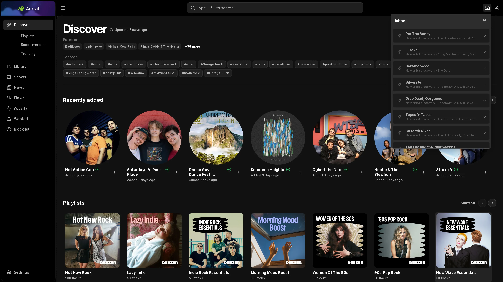
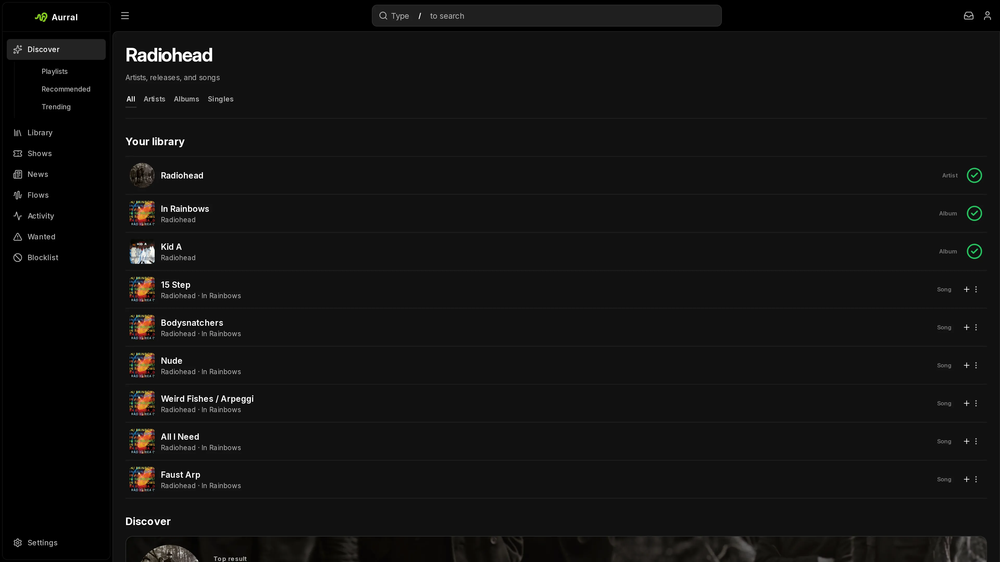
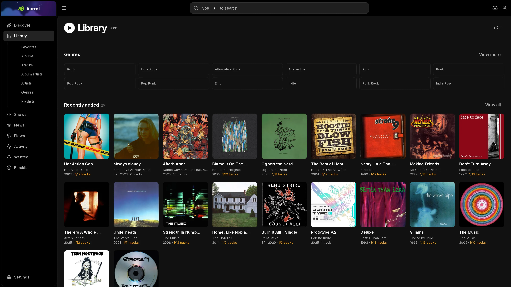
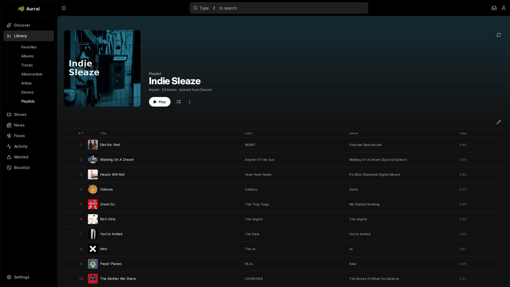
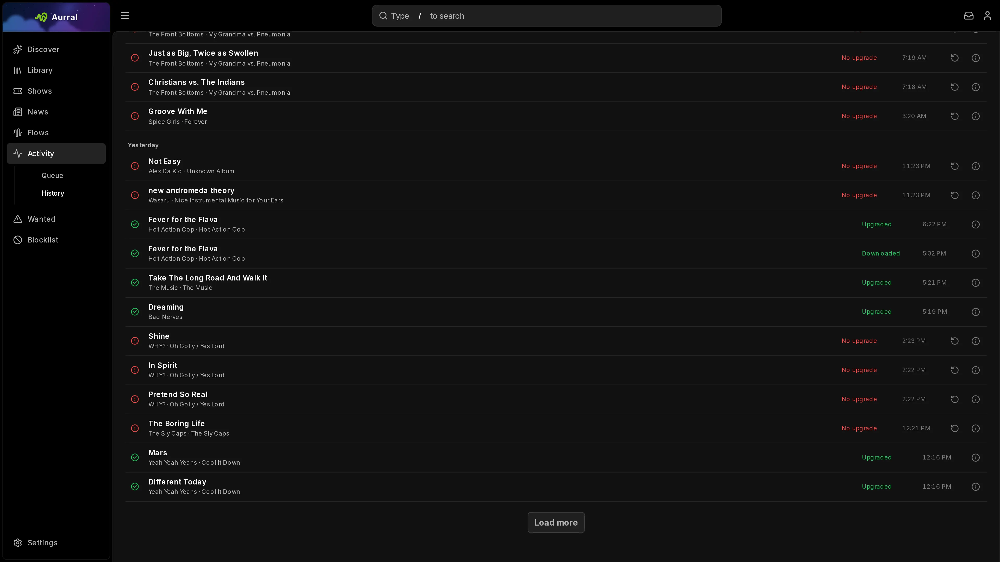
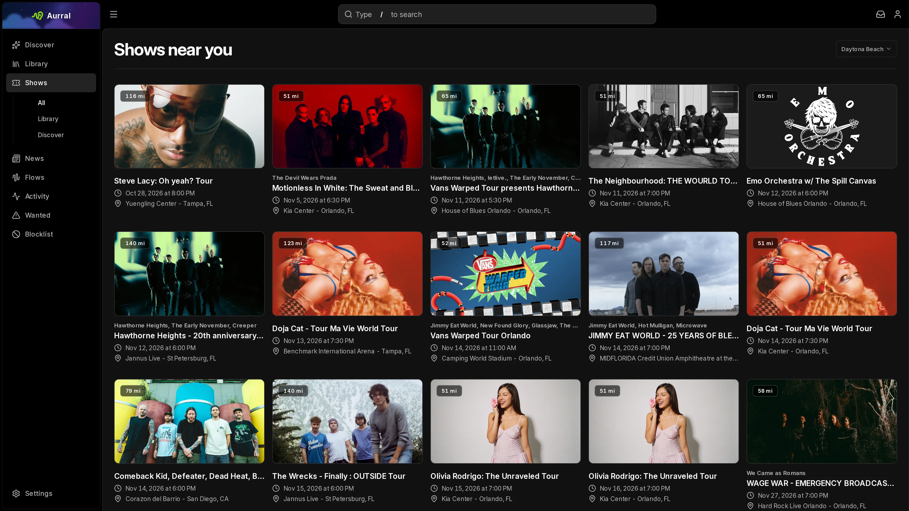
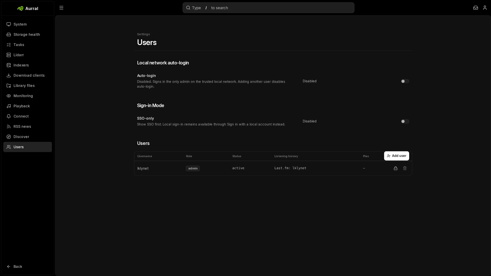

Aurral indexes the music in its Downloads Folder, in read-only folders you add, and, if you connect Lidarr, in the Lidarr root folders. This page describes each part of the app.

## Main sections

### Discover

Discover shows recommendations, trending artists, tags, recent and upcoming releases, playlists, artist news, and nearby shows. Each user chooses which sections appear and in what order. See [Discover](/using/discover/).

### Inbox

The bell icon beside the profile menu opens the Inbox. It collects new releases from library artists, nearby shows, artist news, and new discoveries. Each user has their own read, saved, dismissed, and added state. See [Inbox](/using/inbox/).

### Search

Search finds artists, albums, and tags. From the results, you can preview tracks, see what is already in the Library, and add an artist or album.

Matches from your Library appear first, in their own section, and open the Library page. Results from the metadata catalog follow under **Discover**.

### Library

Library lists the artists, albums, and tracks that Aurral has indexed. You can search, sort, play tracks, mark favorites, and open artist and album pages. See [Library](/using/library/).

When Lidarr is connected, Lidarr manages the artists and albums you add and keeps their files in its root folders. Without Lidarr, Aurral manages them and keeps their files in the Downloads Folder. Either way, Aurral downloads the tracks for playlists and flows. Turning Lidarr off removes its music from the Library. See [Who manages your library](/using/library/#who-manages-your-library).

Artist and album pages have a Discover view and a Library view. Select **Open in library** or **Open in Discover** to switch between them.

The manager in charge can also monitor an artist and download its releases. See [Monitor music](/using/library/#monitor-music).

### Playlists and Flows

**Library > Playlists** holds your static playlists and their download status. **Flows** in the sidebar holds your scheduled discovery mixes.

A flow builds a new tracklist on a schedule. A static playlist keeps a fixed tracklist, or follows a Spotify, YouTube Music, Deezer, Last.fm, or ListenBrainz playlist. You can play both in Aurral. Navidrome, Plex, Jellyfin, and other Subsonic clients are optional. See [Playlists overview](/using/playlists/).

### News

**News** in the sidebar lists recent stories from your RSS feeds that mention library artists or recommended artists. An admin turns on news in **Settings > Discovery > News**.

### Activity and Wanted

**Activity** shows downloads, album requests, and playlist jobs. **Queue** lists active work and tracks that wait for your review. **History** lists finished, denied, and failed work.

**Wanted** lists Aurral tracks that are missing or below your quality cutoff. From there, you can search again, choose a download yourself, or search for an upgrade. See [Activity](/using/activity/).

### Blocklist

The blocklist holds the artists and genres that you excluded. Aurral removes blocked artists from recommendations, playlist previews, and future playlist downloads. Blocked genres hide new artists in that genre from recommendations and flows, but never from your Library.

### Shows

When an admin configures Ticketmaster, **Shows** lists nearby concerts for library, recommended, and trending artists.

### Settings

Open Settings from the gear in the sidebar, or select **Profile** in the user menu. Settings opens over the page you are on, and closing it returns you there. On a phone it fills the screen.

Everyone sees the **Account** sections:

| Section          | What it covers                                                                                             |
| ---------------- | ---------------------------------------------------------------------------------------------------------- |
| **Profile**      | Username, password, sign-in methods, your Plex account, and your Lidarr defaults while Lidarr is connected |
| **Listening**    | Listening history source, scrobbling to Last.fm or ListenBrainz, and resetting your discovery tastes       |
| **Appearance**   | Mode, theme, immersive mode, and environment art                                                           |
| **Shared links** | The links you created                                                                                      |

**Appearance** follows your account to other devices:

- Choose **System**, **Light**, or **Dark** mode and a theme. Every theme has a light and a dark version. When a theme has only one, Aurral generates the other.
- **Create theme** starts from the current theme. Pick a background, text, and accent color for each mode. Aurral adjusts text and accent colors that would be hard to read.
- **Import** accepts an exported Aurral theme or a base16 or base24 scheme. Find schemes in the [Tinted Gallery](https://tinted-theming.github.io/tinted-gallery/) and paste the scheme's source file.
- **Immersive mode** is on by default. It takes the accent color from the cover of what's playing and enables artwork colors in background gradients and the player. It also enables decorative search backdrops and tints Discover, search, and similar artist cards on hover. Turn it off to use your theme's colors without these effects.

Admins also see the **Server** sections:

| Section           | What it covers                                                                              |
| ----------------- | ------------------------------------------------------------------------------------------- |
| **General**       | Date format, Subsonic behavior, and the API key                                             |
| **Users**         | Accounts, permissions, sign-in mode, Google and Plex sign-in, and local-network auto-login  |
| **Library**       | The Downloads folder, read-only folders, importing a folder, and cleaning up the Library    |
| **Monitoring**    | Default monitoring rules, searches for missing tracks, and what you removed from monitoring |
| **Downloads**     | Download clients, Prowlarr, the quality profile, the review queue, and remote path mappings |
| **Playback**      | Navidrome, Plex, and Jellyfin                                                               |
| **Discovery**     | Recommendations, Last.fm, Ticketmaster, and news feeds                                      |
| **Notifications** | Inbox, Gotify, and webhooks                                                                 |
| **Lidarr**        | Connection, the **Enabled** switch, defaults, and the community guide                       |
| **Status**        | Storage checks, tasks, the version, and data paths                                          |

Use the search field in Settings to find a setting by name.

Settings saves each change automatically. Connection tests and sync actions have their own buttons. The default monitoring rules have a **Save** button, and Aurral shows what a change would download before it applies it.

To set the date and time format for all users, open **Settings > General > Display**. Choose the browser default, day first, or year first.

Advanced metadata settings are not in the Settings navigation. Search Settings for **Metadata** to open them. See [Metadata and search](/integrations/metadata/).

Release catalogue refreshes have a separate worker in **Settings > Status > Tasks**, so a slow metadata provider does not hold up playlist maintenance. An **Interrupted** run means unfinished work was returned to the queue after shutdown or loss of its execution lease.
