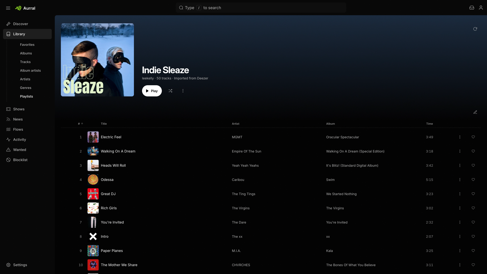

Aurral has two kinds of playlist:

- A **flow** builds a new tracklist on a schedule. Its files are temporary. Open **Flows** in the sidebar to see your flows.
- A **static playlist** keeps a fixed tracklist, or follows a playlist from another service. Open **Library > Playlists** to see your static playlists.

## Flows compared with static playlists

|                  | Flows                                       | Static playlists                       |
| ---------------- | ------------------------------------------- | -------------------------------------- |
| Tracklist        | Built again on a schedule                   | Fixed at import, or follows a provider |
| Failed downloads | Replaced with other tracks                  | Stay failed until you search again     |
| Settings         | Schedule, sources, filters, and Deeper cuts | Import, sync, and file retention       |
| Downloads        | Shared download worker                      | Shared download worker                 |

A static playlist comes from Spotify, YouTube Music, Last.fm, ListenBrainz, an Aurral share, or a flow. A synced static playlist follows the provider's tracklist. See [Playlist imports](/using/playlist-imports/).

## Cover art

Imported playlists keep their original artwork when the source provides it. Other playlists use an artist photo from their tracklist. Generating again picks another artist when a different photo is available. Generated flow covers refresh with each new tracklist; uploads and Simple covers stay as you chose them.

Open a playlist's edit dialog to shuffle an **Artist** or **Simple** cover, or upload your own. Simple covers use a solid color and the playlist title. Cover changes apply when you save. Sync keeps your replacement until you choose **Original**. If no artist photo is available, Aurral creates a simple cover.

## Stop plays from affecting recommendations

Turn off **Scrobble tracks** in a static playlist's menu, or **Scrobble plays** in a flow's editor. Aurral then does not record plays from that playlist in your listening history, your recommendations, or your scrobbling services. Each playlist has its own setting. Plays recorded before the change stay.

## Show track availability

To see the download state of each track in a static playlist, open its playlist menu and turn on **Show track availability**. It is off by default, and each playlist has its own setting.

- A colored mark beside each track shows whether it is available, downloading, queued, missing, or waiting for review. Point at the mark, or move focus to it, to read the state.
- The playlist header shows how many tracks are available.
- To search again for a missing track, use **Re-search** in its track menu.

## Reorder tracks

In a static playlist, select **Select tracks**, then drag a track by its handle, or focus the handle and use Space and the arrow keys. Aurral saves the order in the playlist and its playlist file. A synced playlist follows the provider's order, so it has no handles.

## Playlist files

Aurral writes an M3U file for each enabled flow and each static playlist. Navidrome and Jellyfin import these files as playlists, and Aurral sends them to Plex once an admin connects it. **Settings > Library > Playlist files** shows the folder and whether file names start with the owner's username. See [Navidrome](/integrations/navidrome/#playlists), [Plex](/integrations/plex/#playlists), and [Jellyfin](/integrations/jellyfin/#playlists).

## Retry or replace a track

If every download source fails, the track stays failed, also after a restart. To search again, right-click the track and select **Re-search**. A file or release that already failed Aurral's checks for the track, or failed to download, is not offered again.

To replace a finished track that Aurral downloaded, right-click it and select **Re-search**. Then select **Automatic** to let Aurral choose, or **Manual** to choose a result yourself. The current file stays available until the replacement passes Aurral's checks.

## Remove a playlist or track

Adding a track to a static playlist also adds it to the Library. Removing the track or deleting the playlist keeps its file in the Library.

If the track is still downloading, Aurral cancels the download, unless another playlist has the track, you favorited it, or you added it to the Library yourself.

- If a download client finishes a request after the removal, Aurral does not import the result. The client can still show the work until it reports that the work was cancelled or finished.
- If Aurral cannot cancel a download, the track still leaves the playlist and the download finishes in the Library.
- Aurral does not delete Usenet or deemix files that it cannot prove it owns. If the client finishes after the removal, check its completed-download folder for files that you want to delete.

A synced playlist that does not keep the tracks its source removes is the exception. See [Sync schedule and removed tracks](/using/playlist-imports/#sync-schedule-and-removed-tracks).

Aurral also deletes files on its own, for example when a flow rotates tracks, when a synced playlist drops a track, or after an upgrade. A playlist made in another app does not keep a file. To keep a flow track, add it to the Library or to an Aurral playlist.

## Where files go

Aurral stores static playlist membership as references to Library tracks. Permanent tracks use `Artist/Album/Track` folders in the Library folder. Set this folder in **Settings > Library > Library folder > Path**.

Flow files are temporary. They live under `_flows` in the Library folder.

For setup, see:

- [Filesystem and mounts](/getting-started/storage/)
- [Navidrome](/integrations/navidrome/), [Plex](/integrations/plex/), and [Jellyfin](/integrations/jellyfin/)
- [yt-dlp](/integrations/ytdlp/), [slskd](/integrations/slskd/), [Tidarr](/integrations/tidarr/), [deemix](/integrations/deemix/), and [Usenet](/integrations/usenet/)

## Quality profile

The quality profile sets which audio files Aurral accepts. One profile applies to every download. Only an admin can change it, in **Settings > Downloads > Quality profile**.

The list order sets the rank of each tier. Put the best quality at the top. Turn on each tier that Aurral can accept, and choose one enabled tier as the cutoff.

- An enabled tier at or above the cutoff is **Preferred**.
- An enabled tier below the cutoff is **Upgrade**.
- A disabled or unknown tier is **Below floor**.

The default profile accepts all tiers, with **FLAC standard** as the cutoff.

| Tier                      | Rule for the downloaded file                 |
| ------------------------- | -------------------------------------------- |
| FLAC hi-res               | More than 16 bits, or more than 48 kHz       |
| FLAC standard             | 16 bits or less, and 48 kHz or less          |
| MP3 128, 192, 256, or 320 | Average bitrate, rounded to the nearest kbps |
| AAC 128, 192, 256, or 320 | Average bitrate, rounded to the nearest kbps |

Aurral uses the names and bitrates in search results to rank candidates. It does not trust them to accept a file. After the download, Aurral reads the file and rejects it if its format, bitrate, sample rate, or bit depth does not match an enabled tier. A file with unknown quality is rejected.

A quality rejection does not go to **Activity > Queue**. Queue review is only for tracks with an unclear identity or duration, including **Re-search** replacements.

## Track upgrades

Aurral can upgrade the files that it manages, in the Library and under `_flows`. It does not change files in read-only folders.

An existing file stays available when it is below the cutoff. Aurral replaces it only after it downloads and checks a better file. If several playlists use the file, Aurral updates all of them.

- To upgrade one track, select **Search for upgrade** on the track.
- To upgrade every track below the cutoff, select **Search all** in **Wanted > Cutoff unmet**.

If an upgrade search for a track is already queued, Aurral says so. Any user who can open the playlist can start these searches. Manual searches work when automatic upgrades are off.

To schedule upgrades, turn on **Automatic upgrades** in the quality profile. It is off by default. **Upgrade interval** sets the days between checks for each track, from 1 to 365. The default is 2 days. Automatic upgrades cover every monitored Library track in the Library folder, including music that Aurral did not download.

Upgrade downloads wait behind downloads of missing tracks. Aurral searches slskd, Usenet, deemix, and qBittorrent for upgrades, in track priority order, or album priority order when it looks for one release for several tracks at once. It first looks for the release of the track's album and takes only that track from it. Upgrades that start together for several tracks of one album look for their release once, even when the tracks are in different playlists. Automatic upgrades and **Search all** start all upgrades of an album together. They skip the playlists of a suspended or disabled user until the account is active again. An upgrade that starts while another one downloads a release of the same album waits for that download, for up to 30 minutes. If no source has the release, it searches for the track alone. It stops at the first source that gives a valid, better file. It then waits for the next interval before it tries that track again. Aurral does not use yt-dlp for upgrades.

Aurral never holds an upgrade for review. If it cannot verify a better file, it drops it and keeps the file you have.

## Next steps

- [Flows](/using/flows/): sources, filters, schedule, and how a flow runs
- [Playlist imports](/using/playlist-imports/): Spotify, YouTube Music, Last.fm, ListenBrainz, and Aurral share imports, retries, and file reuse
